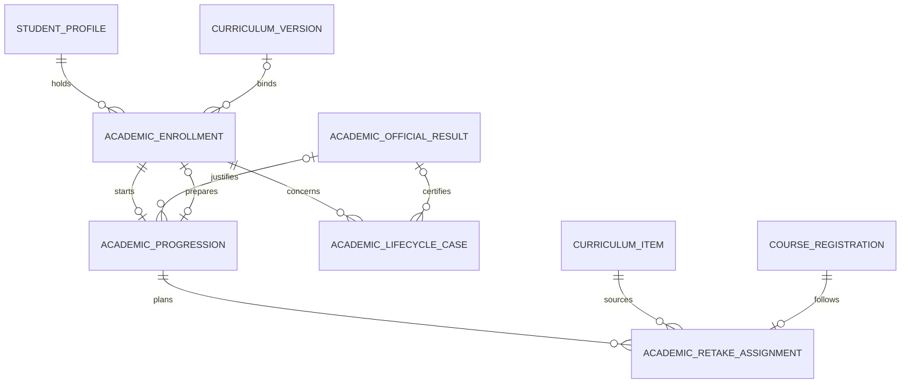

# Modèle du parcours académique

L’identité permanente reste dans `StudentProfile`. Les inscriptions, les maquettes et les admissions composent le parcours. Une décision de progression conserve une inscription source et une éventuelle inscription cible. Les cas de parcours portent une référence, une révision, la proposition, la décision et son contexte. Une reprise liée à une offre conserve l’inscription pédagogique et l’EC source.

Les colonnes ajoutées aux décisions historiques sont facultatives. La migration ajoute les deux tables sans réécrire les dossiers précédents.
