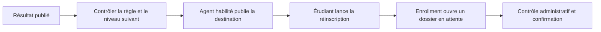

# Passage au niveau supérieur

La destination est le niveau suivant dans l’ordre du programme. Les nouvelles maquettes figent cet ordre dans leur snapshot. Les anciennes utilisent l’ordre disponible du programme. L’année cible doit être ultérieure. La décision conserve l’édition de résultat, la règle et le programme. La réinscription vérifie l’édition actuelle avant création et refuse une maquette cible ambiguë. Un redépôt retourne la cible existante.
