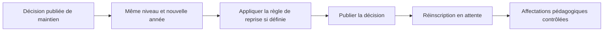

# Redoublements

Le redoublement ouvre un contexte annuel distinct et conserve les notes, résultats et crédits antérieurs. Le plan de reprise intégrale liste les matières du résultat avec leurs statuts et préserve les reconnaissances déjà acquises. Le plan partiel vise les UE non acquises. Ces plans n’écrivent aucun crédit dans Results.
