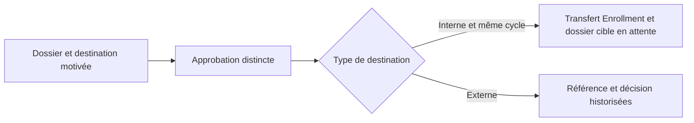

# Réorientations et transferts

La réorientation interne réutilise le transfert Enrollment en année ouverte. L’agent doit être habilité pour les facultés source et cible. La maquette et le niveau sont contrôlés par le transfert, qui préserve le dossier d’origine. Un changement de cycle passe par Admissions.

Le transfert externe est un dossier documenté avec référence. Toute admission, sortie administrative ou reconnaissance de crédits relève de son domaine propriétaire. Aucune synchronisation avec une autre université n’est requise.
