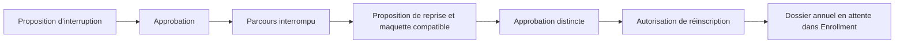

# Interruptions et reprises

Une interruption de parcours est un événement distinct de la suspension du compte et du statut administratif. Elle bloque la progression de cette inscription tant que la reprise n’a pas été approuvée. Les changements de situation annuelle restent traités dans Enrollment. La reprise conserve le matricule et réutilise le parcours existant, avec année ultérieure et maquette explicite. Une ancienne décision sans cible peut être remplacée par la décision de reprise avec audit de son contenu précédent.
