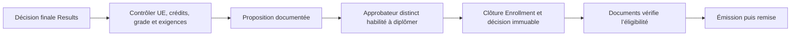

# Fin de cursus et diplomation

Le calcul vérifie le niveau final, la couverture du programme, le grade, les UE obligatoires et les crédits certifiés. Une exigence complémentaire inscrite au règlement demande une référence de vérification. L’approbation recompare les sources à celles préparées. Le service met l’inscription en état terminé et le profil en état diplômé lorsqu’il est actif et sans autre inscription en cours.

Documents exige une validation de fin de cursus encore cohérente avec les résultats publiés, le règlement du type documentaire et le mandat du signataire. L’approbation académique ne génère aucun fichier. Une révision des preuves nécessite une nouvelle décision avant une nouvelle émission. Les diplômes historiques conservent leur archive et leur procédure de révocation.
