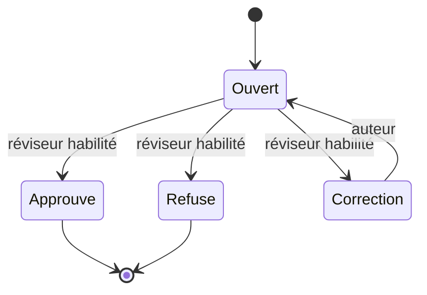

# Permissions et audit

| Rôle ou permission | Actions |
| --- | --- |
| Étudiant | Consulte ses décisions publiées et lance sa propre réinscription autorisée. |
| `publish academic content` | Enregistre la destination correspondant à la décision officielle. |
| `manage academic progression` | Prépare les dossiers de parcours et complète ceux dont il est l’auteur. |
| `approve academic progression` | Approuve, refuse ou demande la correction des dossiers d’un autre auteur. |
| `approve academic graduation` | Habilitation supplémentaire pour approuver la fin de cursus. |
| `manage academic access` | Exécute les actions Enrollment et le rattachement à une offre selon le périmètre. |
| Documents | Applique ses propres droits de création, d’approbation et d’émission. |

Les contrôles Laravel combinent rôle admin, permission, politique du dossier et faculté. Les modifications concurrentes sont contrôlées par verrou et révision. Les cas définitifs restent immuables. Le dépôt est dédupliqué par clé d’opération. Une notification privée est publiée après validation de la transaction.

