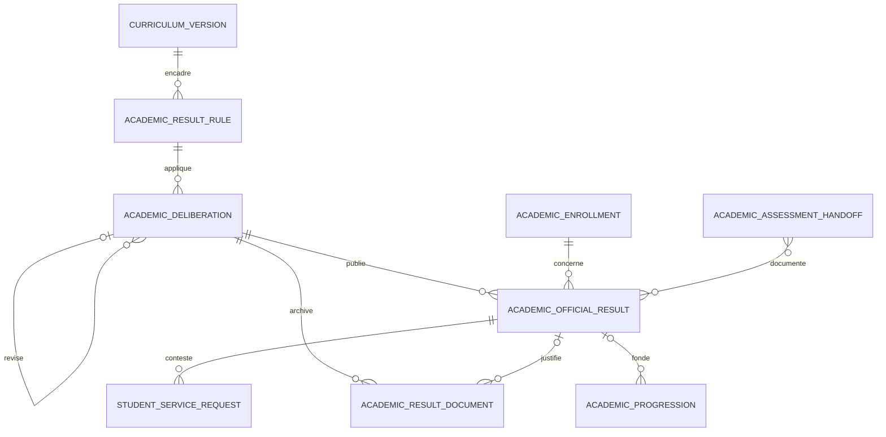

# Modèle des notes et résultats

Une ligne de résultat par dossier et édition conserve les résultats d’EC, d’UE, de période et d’année dans un instantané. La décision du jury est stockée séparément du calcul. La configuration est approuvée et immuable. Les éditions et documents portent des références stables. Les sources d’évaluation sont référencées dans l’instantané, sans recopier les fichiers des travaux.

La migration ajoute des tables et colonnes, sans conversion automatique des notes manuelles ni suppression de documents historiques. Les prérequis s’appuient sur la dernière édition officielle applicable au dossier et à l’UE. En l’absence d’une édition officielle de ce contexte, les résultats d’UE historiques restent utilisables.
