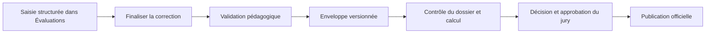

# Saisie et validation

L’enseignant conserve le parcours de la phase 10 pour ses offres et corrections. Results consomme les enveloppes validées reliées aux inscriptions pédagogiques actives, aux EC et aux sources explicitement retenues. Une correction rouverte ou non validée disparaît des entrées d’un nouveau calcul jusqu’à sa validation.

Une absence ou une exemption conserve une note absente. Une note zéro demeure une valeur chiffrée. Une source manquante signale un dossier incomplet. L’import CSV ou Excel de notes demeure différé. L’export CSV porte sur une édition officielle déjà publiée.
