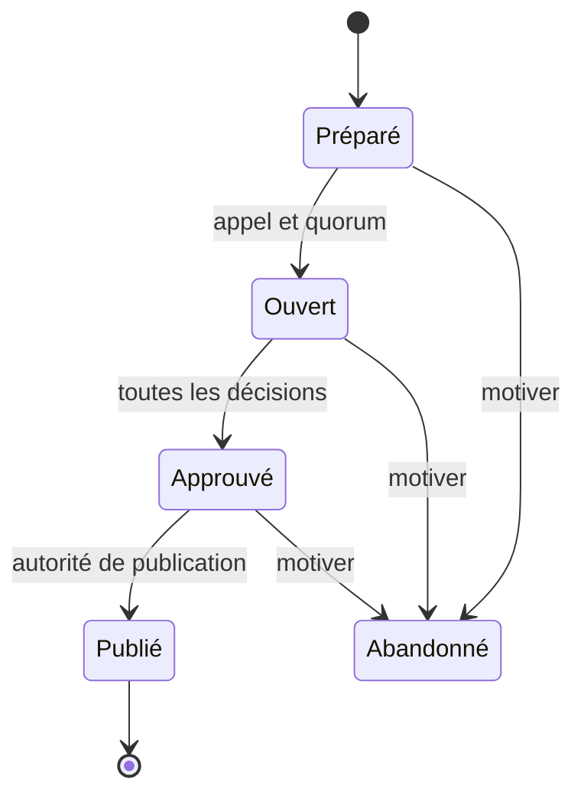

# Jury et décisions

Les comptes du jury sont vérifiés et habilités dans la faculté. La présidence et le secrétariat sont distincts et figurent dans l’appel. Le président ouvre et approuve. Les membres présents enregistrent les décisions et leurs motifs. Les formulaires utilisent une révision attendue pour éviter la perte de modification.

L’approbation verrouille le calcul et les décisions. Une rectification repart dans un nouveau dossier de jury lié à la dernière édition publiée. Les anciens résultats et documents restent consultables.
