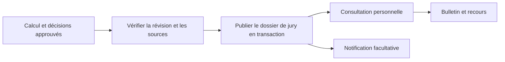

# Publication des résultats

La visibilité dépend d’un état publié et d’un instant de publication sur le dossier de jury. Tous les résultats de l’édition deviennent visibles ensemble. Les pages étudiant vérifient l’inscription et la règle existante `results_view` à chaque lecture, téléchargement et dépôt de recours.

Le portail Résultats présente l’historique officiel à côté des publications personnelles historiques. Les brouillons, anomalies internes et enveloppes détaillées ne sont pas transmis aux étudiants. Les notifications ne contiennent ni note, ni décision, ni pièce.
