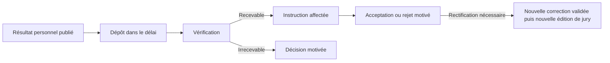

# Recours et rectifications

L’étudiant choisit la décision ou un EC de son édition et peut joindre un PDF ou une image. Le délai vient du règlement. Le même résultat et la même cible ne créent qu’un seul dossier. L’administration vérifie, affecte et décide selon ses permissions. Les états accepté, rejeté et irrecevable sont terminaux. Le traitement utilise les demandes existantes, avec une route spécialisée.

L’acceptation d’un recours n’altère pas la publication. Lorsque la correction pédagogique a été révisée et revalidée, le nouveau dossier peut citer le recours accepté et la dernière publication. Les documents de l’ancienne édition restent archivés. Les dérogations au délai et l’instruction en plusieurs degrés nécessitent un règlement et un workflow supplémentaires.
