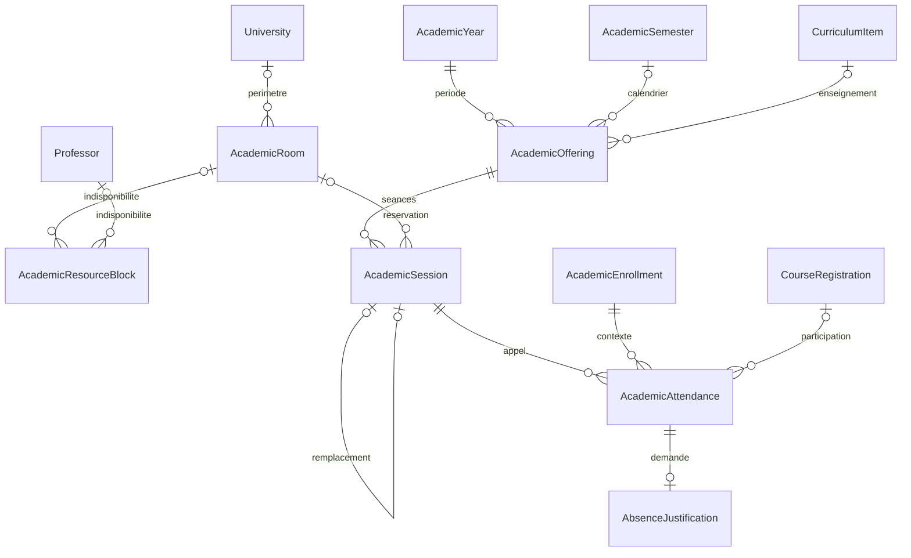

# Architecture de planification

Le moteur demeure dans le module Teaching. `ScheduleService` contrôle et écrit les créneaux, `ScheduleResources` vérifie salle, capacité et indisponibilités, `SessionLifecycle` gère les transitions, et `AttendanceAccess` autorise l’appel. `CourseAudience` reste la source du public pédagogique. `AcademicAccessService` applique les règles étudiantes, y compris les restrictions existantes liées à la finance.

Une séance garde une seule offre et dérive l’année, la période, l’équipe et le groupe de ce lien. Les dates sont interprétées en Africa/Kinshasa et enregistrées en UTC. Les salles historiques restent lisibles grâce au libellé existant. Les changements sensibles réutilisent `academic_audits` et le canal Laravel de notifications.

| Entrée | Route |
|---|---|
| Calendrier et création | `GET/POST /dashboard/admin/schedule` |
| Plan semestriel | `POST /dashboard/admin/schedule/semester` |
| Modification ou suppression d’un brouillon | `PUT/DELETE /dashboard/admin/schedule/{session}` |
| Transitions et historique | `POST /dashboard/admin/schedule/{session}/transition`, `GET /dashboard/admin/schedule/{session}/history` |
| Salles et ressources | `GET /dashboard/admin/schedule/resources`, `POST /rooms`, `PUT /rooms/{room}`, `POST /blocks`, `POST /blocks/{block}/release` sous le préfixe de planning |
| Appel administratif | `GET/POST /dashboard/admin/schedule/{session}/attendance` |
| Planning et appel enseignant | `GET /dashboard/teacher?week=AAAA-MM-JJ`, `GET/POST /dashboard/teacher/sessions/{session}/attendance` |
| Planning étudiant | `GET /dashboard/student/schedule?week=AAAA-MM-JJ`, fiche cours et accueil existants |
| Justifications | `GET /dashboard/student/absences`, `POST /dashboard/student/absences/{attendance}`, téléchargement privé sous `/absences/{case}/file` |
| Examen | `GET /dashboard/admin/schedule/absences`, `POST /absences/{case}/decision`, `GET /absences/{case}/file` sous le préfixe de planning |
| Rapports | `GET /dashboard/admin/schedule/reports`, paramètre `format=csv` |

La migration additive ajoute trois tables et des champs aux séances et présences. Elle ne remplace ni les offres, ni les événements du calendrier, ni les lignes d’appel.
