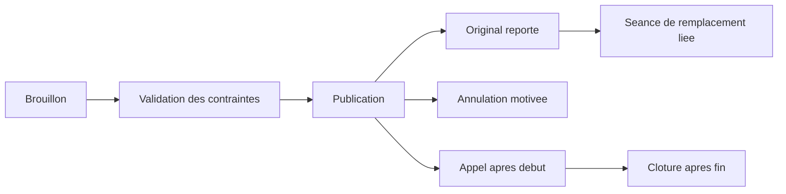

# Publication, report et annulation

L’interface propose validation puis publication. Les routes compatibles et la publication d’une maquette peuvent vérifier et publier dans une seule transaction. La publication de la séance versionnée exige l’offre publiée et son responsable actif. Les anciennes offres restent compatibles avec leur modèle d’affectation.

Le report exige un créneau à venir et un motif. Le lien `replaces_session_id` relie l’original à un remplacement unique. Un échec de disponibilité préserve la réservation initiale. Une demande identique peut être rejouée. L’annulation garde le créneau d’origine et le motif, libère la réservation et indique le statut aux personnes concernées.

Les séances publiées ne se suppriment plus depuis les anciennes routes. La suppression d’un brouillon reste possible sous contrôle. Une séance publiée commencée ou avec appel ne se déplace plus. La clôture d’appel suit la fin de séance. Le détail administratif affiche l’historique paginé et les liens de report. Les étudiants voient les badges de statut dans leur emploi du temps. Les séances annulées sont retirées du comptage des séances à suivre sur l’accueil.
