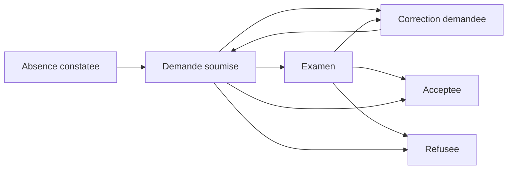

# Justifications d’absence

L’étudiant ouvre ses absences dans le planning ou dans la fiche de cours. Une demande peut inclure un PDF, JPEG ou PNG de 5 Mio maximum. L’absence doit être personnelle, enregistrée et liée à une séance publiée terminée. Le constat reste absent après acceptation. Le dossier 360°, la fiche de cours et les rapports présentent alors sa qualification justifiée.

Les agents disposant de `manage academic access` examinent les demandes de leur faculté. La décision exige un motif et la version de la demande. Les états accepté et refusé sont terminaux. Une correction demandée permet une nouvelle soumission. Les soumissions précédentes et leurs pièces sont référencées dans un historique masqué de la demande. Les décisions sont auditées sans inscrire le motif confidentiel dans le journal général.

Le stockage est privé et les téléchargements sont contrôlés côté serveur. Les pièces, raisons et chemins ne figurent pas dans les listes enseignantes ni les notifications. La page de décision montre la pièce courante. La durée de conservation des anciennes pièces relève de la politique de l’établissement.
