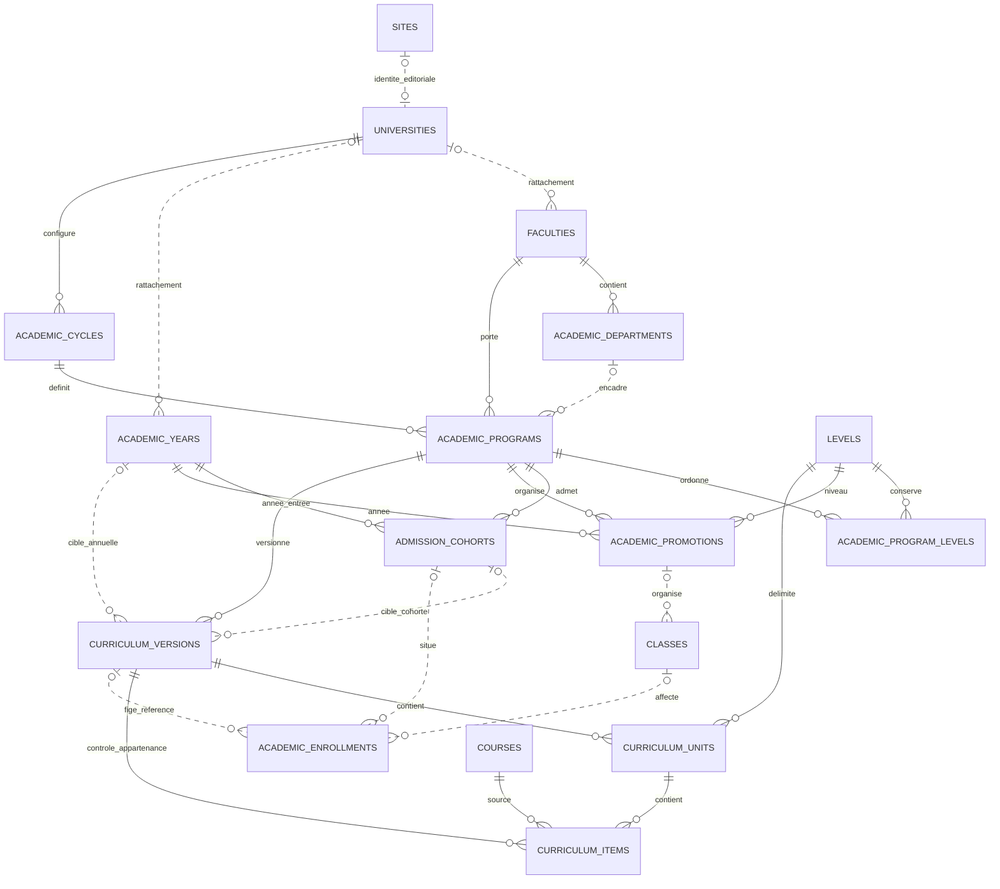

# Relations de données

Les liens en pointillé partent des références nullables. Facultés, sites, niveaux, cours, années, classes et inscriptions existaient avant la phase.

La clé composite (unité, version) sur une matière impose son appartenance à la bonne version. L'unique (version, cours source) interdit les doublons. L'unique de publication protège un contexte annuel ou de cohorte ; la règle exclusive année/cohorte est vérifiée par le service. Les champs de validation et de publication référencent les utilisateurs.
