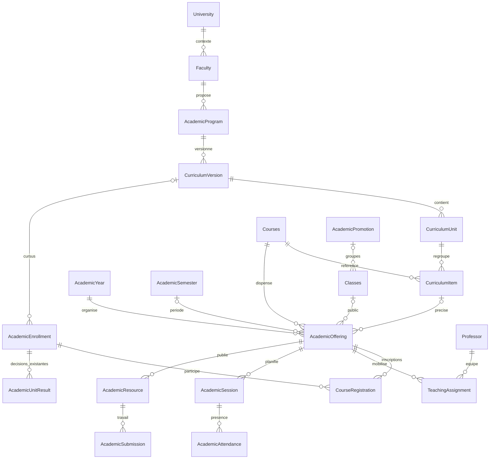
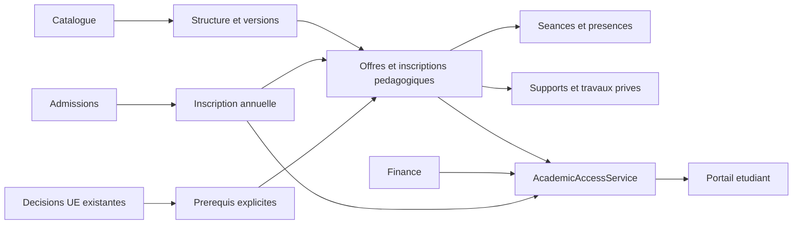

# Modèle et dépendances

| Concept | Modèle / table |
|---|---|
| Définition catalogue | `Courses` / `courses` |
| Programme / UE / EC | `AcademicProgram` / `academic_programs`, `CurriculumVersion` / `curriculum_versions`, `CurriculumUnit` / `curriculum_units`, `CurriculumItem` / `curriculum_items` |
| Offre réelle | `AcademicOffering` / `academic_offerings`, avec EC facultatif pour la compatibilité |
| Participation réelle | `CourseRegistration` / `academic_course_registrations` |
| Affectation et historique | `Professor` / `professors`, `TeachingAssignment` / `academic_teaching_assignments` |

L’institution se déduit de la faculté et de la version (instantané). L’année et le programme doivent être compatibles ; pas de tenant SaaS ajouté. L’inscription annuelle possède le rattachement académique, Teaching possède la participation par offre, Finance garde ses règles, Academic Access applique publication, public et conditions d’accès.

La migration `2026_11_10_100000_consolidate_academic_teaching.php` ajoute les champs et deux tables. Aucune table de cours, UE, EC ou offres n’est recréée. Les FK des nouvelles relations empêchent l’effacement des historiques liés ; les clés d’activité uniques ne s’appliquent qu’aux nouveaux rattachements. La migration ne recalcule aucun résultat.
