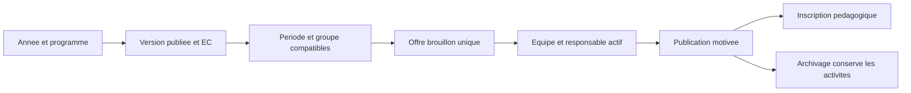

# Offres d’enseignement

`AcademicOffering` continue de porter les séances, supports et relations existantes. Une offre gérée avec la phase 07 ajoute un EC précis, une période (semestre institutionnel ou dates propres), un prérequis UE facultatif et l’état d’archivage. Le groupe, s’il est choisi, doit relever d’une promotion du programme, du niveau et de l’année. Un public commun peut rester sans groupe. Les cycles et périodes de maquette ne sont pas limités au LMD.

Depuis `/dashboard/admin/teaching`, filtrer l’année et le programme puis la version publiée. Le formulaire propose les EC et les groupes du niveau choisi. Le serveur contrôle année/version, niveau, institution, période, état du catalogue, public et permission. Une période personnalisée peut couvrir l’année ou les dates retenues ; les bornes sont vérifiées. La clé `teaching_key` associe année, EC et groupe ; rejeu identique sans offre supplémentaire, paramètres divergents refusés. Un verrou de calendrier partagé avec le service historique évite un chevauchement concurrent du public. Une ancienne offre ambiguë en chevauchement n’est ni dupliquée ni convertie silencieusement.

Le brouillon reçoit un responsable actif avant publication. L’archivage conserve les inscriptions et activités. Il bloque nouvelles inscriptions, affectations, ressources et planification ; les séances passées restent accessibles selon les droits. Les anciennes offres gardent leurs routes historiques et l’affectation par niveau.

La vue détail pagine équipe, inscriptions, séances et ressources et affiche UE/EC, crédits, coefficient, public et période. Les indicateurs filtrés indiquent totaux, publiées et archivées. Les outils existants de supports et d’horaires restent accessibles par liens.
