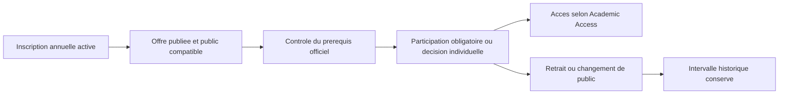

# Inscriptions pédagogiques

`CourseRegistrationService` crée des participations liées à une inscription annuelle et à une offre versionnée. Candidats : inscription confirmée, profil actif, admission validée, année/niveau/maquette et, le cas échéant, département et groupe concordants. Une inscription financièrement insuffisante ne bénéficie d’aucun accès supplémentaire : Academic Access applique toujours ses règles après ce contrôle.

L’agent avec `manage academic access` peut synchroniser le public obligatoire d’une offre (lots de 200, transaction, réexécution sans doublon) ou enregistrer une inscription individuelle motivée : obligatoire, option, reprise ou dérogation. La synchronisation ne choisit pas d’options. Un retrait manuel empêche la réinscription automatique ; une décision individuelle explicite peut rouvrir une nouvelle participation. Chaque intervalle garde sa date, son auteur, sa fin et un audit.

Un prérequis désigne une autre UE publiée du programme. Il ne s’appuie que sur une décision `AcademicUnitResult.validated` d’un contexte du même profil. Une dérogation administrative motivée peut lever ce seul prérequis, jamais la portée de l’offre. La reprise est attestée par l’agent ; ni équivalence ni validation de crédits n’est déduite.

Le changement officiel de groupe/département clôt les participations hors du nouveau public dans la transaction de l’inscription annuelle. L’agent synchronise ensuite l’offre cible. Les séances du passé utilisent l’intervalle de participation et l’historique de groupe ; l’accès aux supports du groupe précédent prend fin. Les anciennes offres continuent à utiliser `CourseException` et le public historique.
