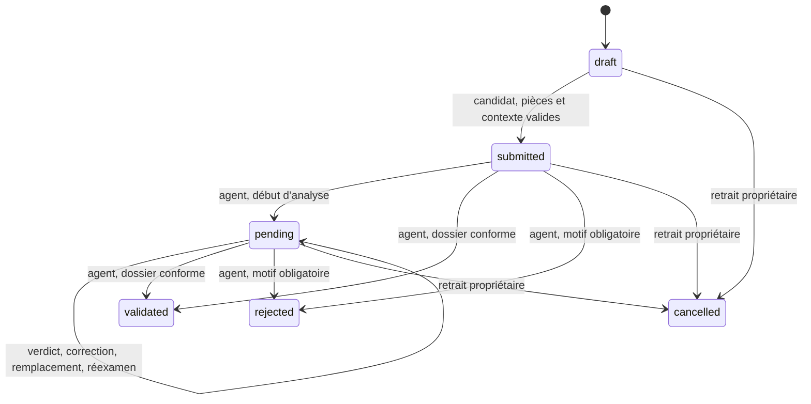

# États et transitions

| Transition | Préconditions | Historique et communication |
|---|---|---|
| Sauvegarder le brouillon | Propriétaire, statut brouillon, échéance valide | Date de mise à jour |
| Soumettre | Confirmation explicite, contexte admissible, fichiers requis présents, absence de doublon | Événement submitted, matricule, accusé après commit |
| Démarrer l’analyse | Agent habilité, soumis ou en attente | Événement analysis_started et notification existante |
| Examiner ou remplacer | Analyse en cours, pièce liée, motif pour verdict défavorable, propriétaire pour remplacement | Verdict, auteur, version, notification et compte rendu |
| Admettre | Contexte encore admissible, pièces acceptées et requises, état compatible | Décision validated et ouverture de l’espace étudiant |
| Refuser | État compatible, motif explicite | Décision rejected et communication du motif |
| Retirer | Propriétaire, dossier sans décision | Événement cancelled idempotent, historique préservé |

Les pièces en correction et le réexamen utilisent les états documentaires sous pending. Les décisions définitives restent terminales via les routes actuelles. Les dossiers historiques déjà examinés peuvent passer directement de submitted à validated lorsque les préconditions sont remplies. La fin de la période de dépôt ne bloque pas la décision sur un dossier déjà reçu si l’année et le programme restent admissibles.
