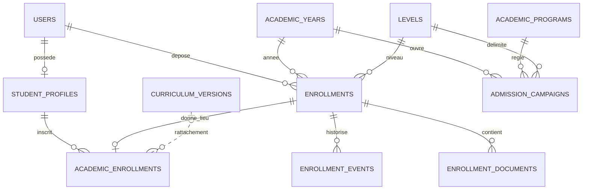

# Transition vers l’espace étudiant

Le candidat dispose déjà d’un compte. Son email est vérifié par les routes Identity et son accès est récupérable par le mécanisme existant de mot de passe. La validation ajoute le rôle étudiant au compte, réutilise le profil par identifiant utilisateur et conserve le matricule acquis à la soumission. L’email d’admission et la notification pointent vers un espace authentifié. Ils ne constituent pas des jetons d’activation. Les liens signés existants de vérification d’adresse et de récupération ont leurs propres règles d’expiration.

Une inscription annuelle nouvelle est créée en attente de confirmation. Le portail donne accès aux informations initiales et aux démarches. Les cours, dépôts et évaluations restent soumis à l’éligibilité de l’inscription, aux règles académiques et aux règles financières existantes. Un agent peut confirmer l’inscription via Situation académique avec un motif. Les inscriptions déjà confirmées gardent leur état.

Le programme demandé est référencé par ID dans le dossier. Le rattachement à une maquette annuelle unique réutilise le service de la phase 02. Les dossiers ambigus restent à examiner.
