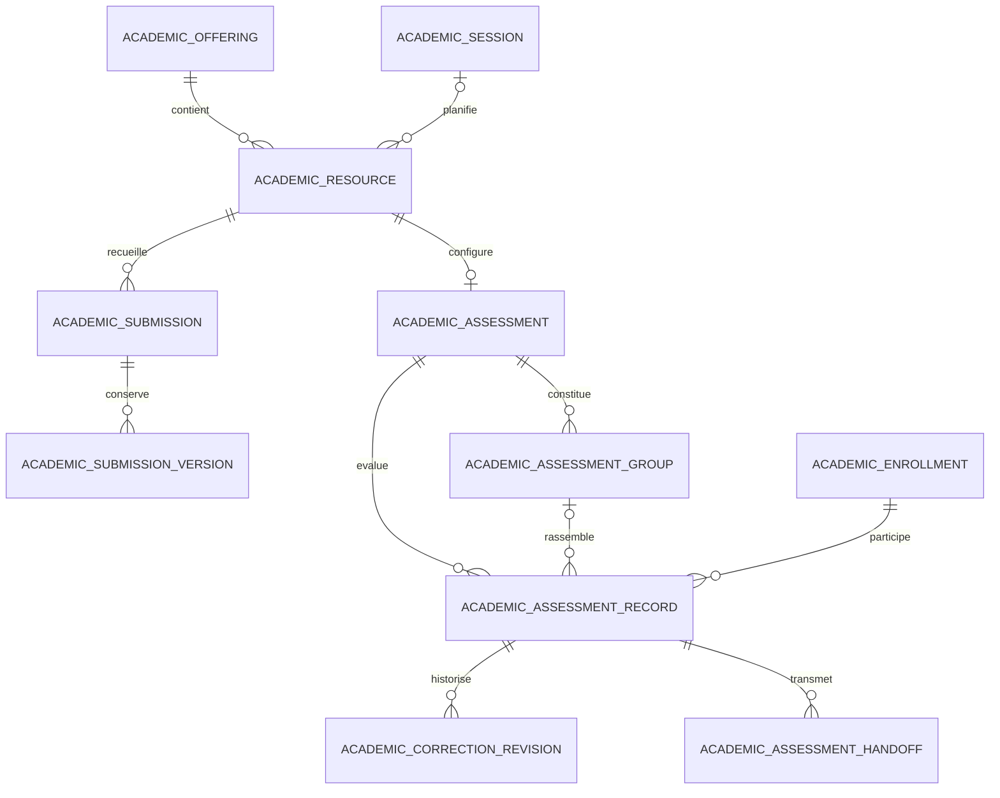

# Modèle des évaluations

L’identifiant de ressource reste le point d’entrée des cours et du portail. L’extension 1–1 décrit la configuration d’une nouvelle activité. La tentative de remise correspond à une version reçue. En présentiel, une ligne de participant conserve la situation issue du constat de présence ou d’une décision motivée.

Les clés étrangères protègent les relations. Les contraintes uniques couvrent la configuration par ressource, le participant par évaluation et inscription, la version et le rejeu par copie et la révision transmise par participant. La migration est additive et ne comporte pas de conversion implicite des devoirs ou résultats.
