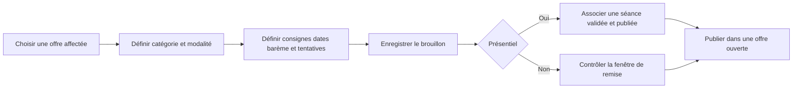
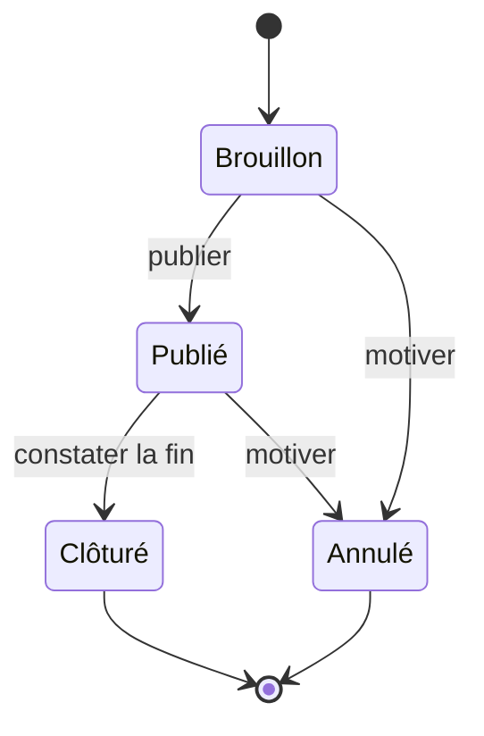

# Planification et publication

Le créneau nominal et la tolérance de remise doivent rester dans les dates de l’offre, du semestre ou de l’année applicable. Les formulaires affichent les dates à Kinshasa et le serveur persiste les instants en UTC. L’ouverture est dérivée de l’heure serveur. La clôture est explicite après la fin de l’épreuve ou de la tolérance. L’annulation retire la publication et conserve les remises existantes. Les évaluations clôturées conservent leurs corrections.

Les dates, le lieu et la durée d’un examen viennent du planning. La gestion des conflits reste dans ce module. La publication peut notifier l’audience actuelle. Un examen annulé dans le planning doit être traité dans le suivi des évaluations avant toute correction.
