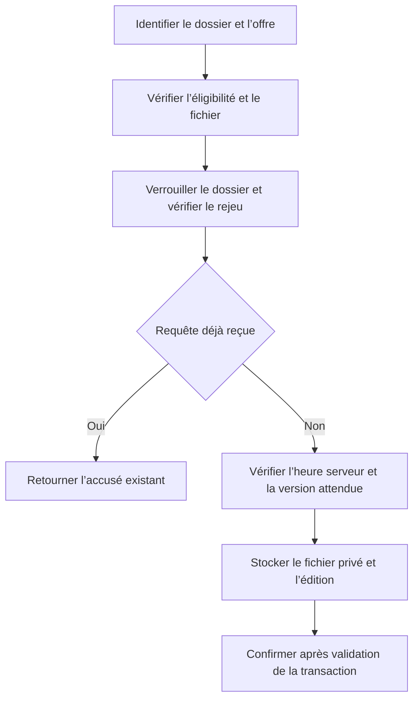

# Devoirs et soumissions

Les remises utilisent la route historique et acceptent un texte et un fichier PDF ou image. Le serveur vérifie l’extension, le MIME réel et le plafond existant de 10 Mio ajusté aux limites PHP. Un remplacement sans fichier conserve la pièce précédente. La tentative indique l’heure serveur de réception et le retard éventuel dans la tolérance.

Les activités de la phase 10 exigent un UUID d’opération et la version attendue. Une répétition identique ne consomme pas de tentative. Deux contenus envoyés avec le même UUID sont refusés. Un formulaire ancien reste accepté sur les devoirs historiques. La version courante est capturée lors de son premier remplacement. Les éditions plus anciennes sont récupérées à partir des instantanés déjà disponibles dans l’audit. Leur heure exacte peut être inconnue.

Le texte et les fichiers des versions sont consultables par le déposant, son groupe autorisé et les correcteurs habilités. Une écriture échouée annule la mutation et la création de l’accusé. Les fichiers historiques manquants sont signalés par une réponse HTTP 404.
