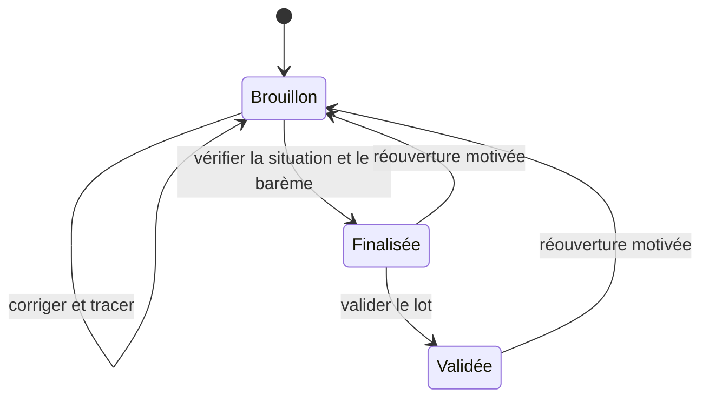

# Corrections pédagogiques

La correction débute après la clôture. Le correcteur parcourt les participants et leurs versions privées. Il renseigne la participation, la note ou la grille, l’appréciation et éventuellement un fichier corrigé. La finalisation exige une situation explicite et des valeurs valides. Une absence, une non-remise ou une dispense conserve une note nulle au sens SQL. Un zéro saisi est réservé à une participation évaluée.

Chaque enregistrement et transition crée une révision consultable. La révision attendue protège contre les formulaires périmés. L’autorité administrative peut rouvrir la correction en motivant l’action. La réouverture suspend l’affichage du feedback et conserve les anciennes révisions, y compris les fichiers et les transmissions.

La diffusion du feedback est un acte distinct. La configuration choisit le seuil de finalisation ou de validation. L’étudiant consulte uniquement sa correction et l’appréciation collective autorisée. La règle centrale de consultation des résultats s’applique. Une année clôturée peut conserver le feedback consultable même si la participation est fermée. Une demande de révision utilise les demandes administratives existantes, à raison d’une demande par révision publiée.
