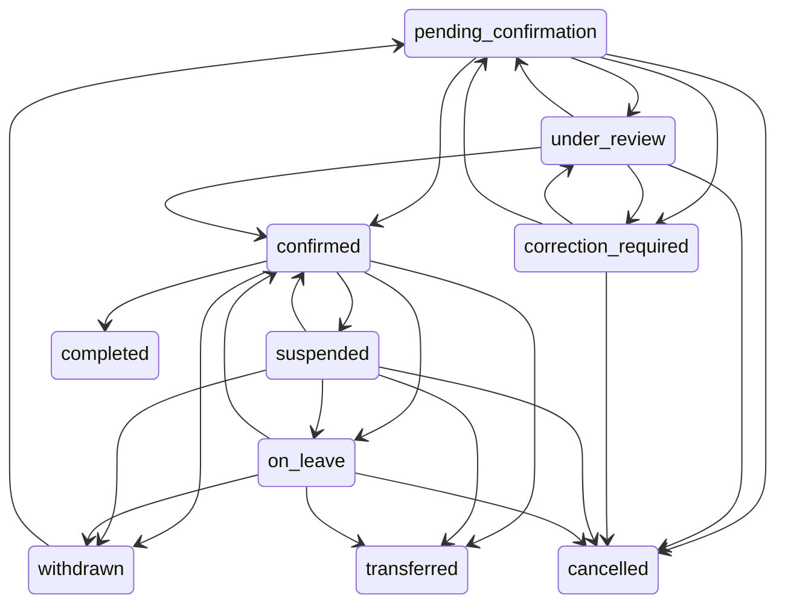

# Machine à états annuelle

Service : `AcademicEnrollmentService::TRANSITIONS`. La politique académique permanente (`student_status`) et les règles financières restent distinctes.

Les nouveaux formulaires transmettent aussi `expected_status` : une décision saisie sur un état périmé est refusée après verrouillage.

Chaque transition exige un administrateur habilité, le périmètre autorisé, une année ouverte, un motif et une clé UUID. Une reprise vers `confirmed` vérifie profil actif, admission et condition financière configurée. La clôture d’une inscription ne crée ni note ni réinscription. `completed`, `cancelled` et `transferred` sont terminaux, y compris pour les changements ordinaires de groupe.

Le transfert utilise son endpoint spécialisé, jamais une modification libre vers `transferred`. Un changement de groupe ou de département au même statut est une décision auditée. Dates d’effet immédiates ; pas de décision future appliquée prématurément. Fin de suspension/congé indicative, sans reprise automatique.

La même clé et le même contenu retournent le résultat existant ; une clé réutilisée avec un contenu différent est refusée. Verrouillage : année, profil, inscription, groupe. Trois tentatives transactionnelles en cas de concurrence. Les notifications de décisions sont écrites dans la même transaction en base et ne sont pas dupliquées au rejeu.

`expected_context` complète `expected_status` dans les nouveaux formulaires. Il détecte notamment une réaffectation concurrente de groupe, de département ou de maquette, même lorsque le statut n’a pas changé. La comparaison se fait après verrouillage ; un rejeu identique est reconnu avant ce contrôle. Une décision sans changement de valeurs possède aussi sa clé d’opération et n’est notifiée qu’une fois.

Une décision peut porter `service_request_id` et `student_response`. La demande doit être ouverte et appartenir exactement au contexte source. Sa réponse destinée à l’étudiant est distincte du motif administratif interne ; `StudentRequestService` la résout dans la même transaction. Une erreur de propriété, de demande résolue ou de rattachement de maquette annule la décision complète.
