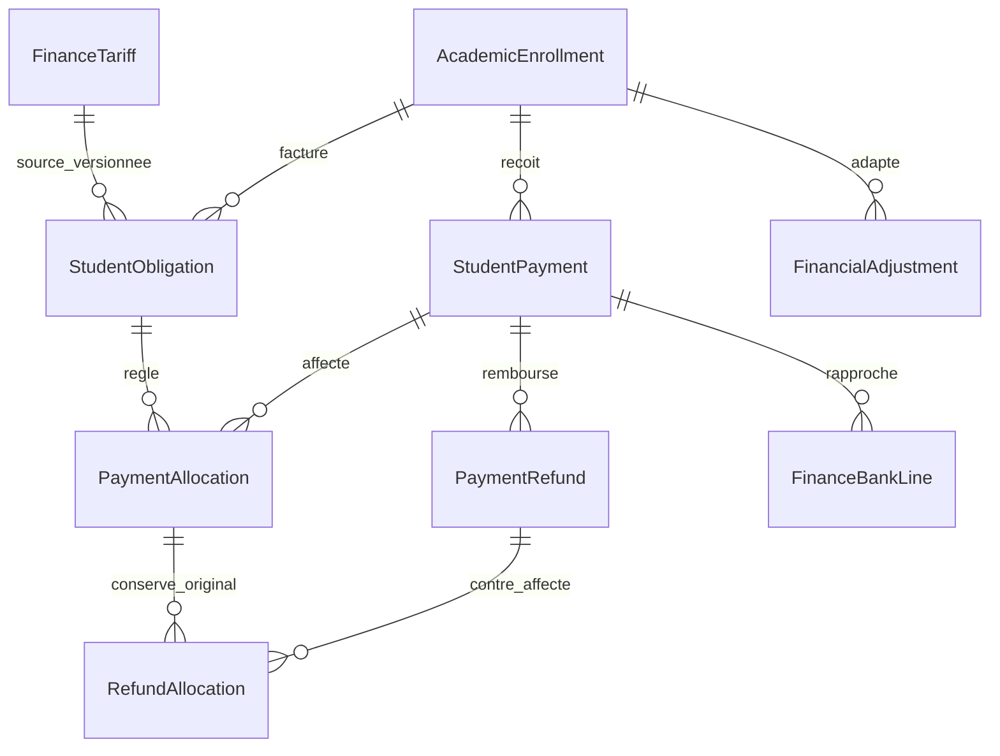

# Modèle financier et intégrité

Les tables historiques `student_obligations`, `student_payments` et `student_financial_adjustments` restent propriétaires des données. Les modèles nouveaux sont dans `app/Models/Student`; les services restent sous `app/Modules/Student/Application/Services`.

`FinanceTariff` conserve périmètre, version, devise, validité, échéances et auteur. L'obligation conserve `finance_tariff_id`, `currency` et `source_snapshot`. Le paiement conserve référence unique, cents, devise, moyen, auteurs, dates, statut et `receipt_snapshot`. Les aides conservent leur décision, financement, pourcentage en points de base et montant fixé à l'octroi.

`Money::cents` accepte exclusivement des chaînes décimales ou entiers : deux décimales maximum, montant positif ou nul selon opération, neuf chiffres entiers maximum. Les flottants binaires, exposants et précision excédentaire sont rejetés. `Money::decimal` produit une chaîne exacte. Les pourcentages sont arrondis à l'unité mineure, moitié vers le haut. Aucun calcul de solde n'est confié à React.

`config/finance.php` limite les nouvelles opérations à USD et CDF à deux subdivisions décimales. Pas de taux, pas de conversion, pas de total multidevise. Une nouvelle devise exige une décision explicite sur sa précision et la compatibilité des champs existants.

`StudentFinanceService::statement` est le moteur du relevé : obligations moins aides institutionnelles actives, paiements confirmés nets de remboursements exécutés, affectations nettes des contre-affectations. Les anciens versements par catégorie couvrent FIFO les échéances de cette catégorie. Les versements `unallocated` ne règlent aucune dette avant affectation. L'excédent est un crédit affiché séparément ; il ne crée pas une dette négative et n'est pas transféré automatiquement entre catégories.

`FinanceReportingService` est une projection SQL à la lecture, sans solde stocké ni cache à invalider. Les tests comparent ses résultats au relevé, notamment pour plans, aides et remboursements. Cette projection doit évoluer avec le moteur et conserver ces tests de cohérence.

Les modèles bloquent modification/destruction d'obligations, affectations et contre-affectations ; les montants de paiements validés restent immuables. `FinanceMutation` est un garde technique interne, pas une autorisation. Les services appliquent toujours permission et périmètre avant mutation. Les décisions d'aide sont révoquées ou remplacées, jamais supprimées.

## Migration

Migration additive `2026_11_07_160000_consolidate_finance.php` : cinq tables nouvelles, champs de source/reçu et paramètres d'aide, contraintes uniques et index ciblés. Les champs historiques nouveaux sont nullable, sans requalification automatique des anciennes données. Un retour arrière destructif est explicitement refusé par `down()`.

Avant application réelle : sauvegarde vérifiée, inventaire des devises et doublons existants, mesure des volumes/index sur une copie représentative, déploiement coordonné code/schéma, contrôle des totaux avant/après. En incident, conserver le schéma et revenir au code compatible après analyse ; toute suppression exige un plan de conservation distinct. Aucune migration de la base réelle n'a été exécutée pendant cette phase.
