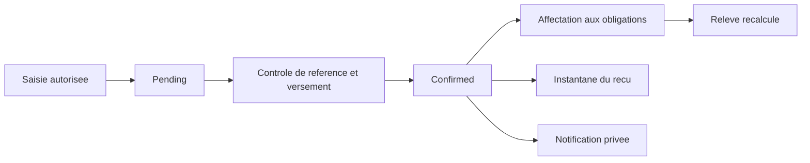
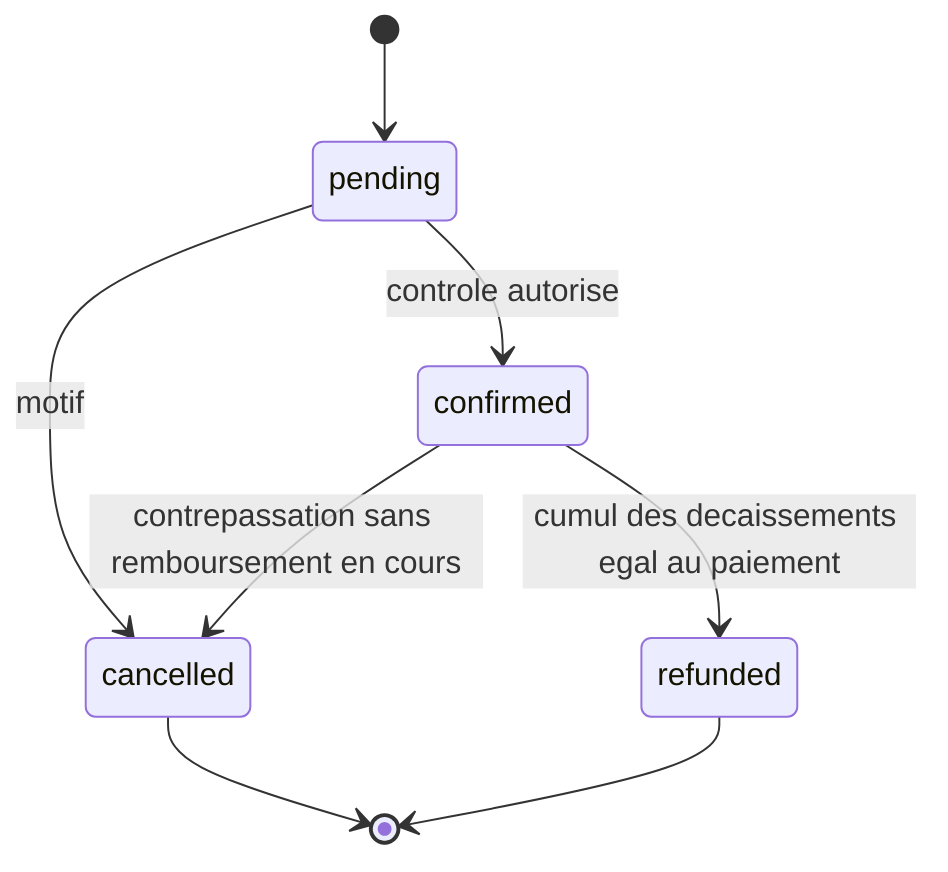

# Paiements et affectations

Les routes historiques de saisie restent sous `/dashboard/admin/student-academic` : `/{academic}/payments`, `/payments/{payment}/status`. Le nouveau back-office les appelle ; il ne possède pas un moteur parallèle. Les moyens configurés restent espèces, virement et autre. Aucun mobile money ni chèque spécifique n'est activé automatiquement.

Un remboursement partiel conserve `confirmed`, avec un montant remboursé distinct. `refunded` n'est plus une transition administrative directe. Un état terminal ne peut être réactivé : corriger avec une nouvelle opération documentée.

`record` accepte un même numéro de référence seulement si contexte, montant, devise, catégorie et mode correspondent exactement. Un conflit donne une erreur sur `reference`; la contrainte SQL reste le dernier rempart. Une confirmation identique est sans effet supplémentaire, notamment pour reçu, audit et notification. Les transactions verrouillent le contexte puis le paiement ; création et affectation utilisent trois tentatives sur conflits transactionnels pris en charge par Laravel.

`PaymentAllocationService::allocate` affecte un paiement confirmé `unallocated` à plusieurs obligations du même contexte et de même devise. Un versement peut couvrir plusieurs dettes, une dette plusieurs versements. Plafonds : argent disponible et reste dû de chaque obligation, au plus 24 lignes par demande. La paire paiement/obligation est unique. Rejeu exact sans contre-affectation : aucun doublon ; montant différent : refus. Une affectation publiée ne se réécrit pas. Un remboursement en cours bloque une nouvelle affectation.

Les paiements historiques par `kind` gardent leur application FIFO implicite, sans migration artificielle en affectations. Le crédit et les versements non affectés restent visibles. Il n'existe pas encore de workflow autonome de réaffectation arbitraire ni de gestion de litiges prestataire : une correction exige une opération de contrepassation/remboursement autorisée.
