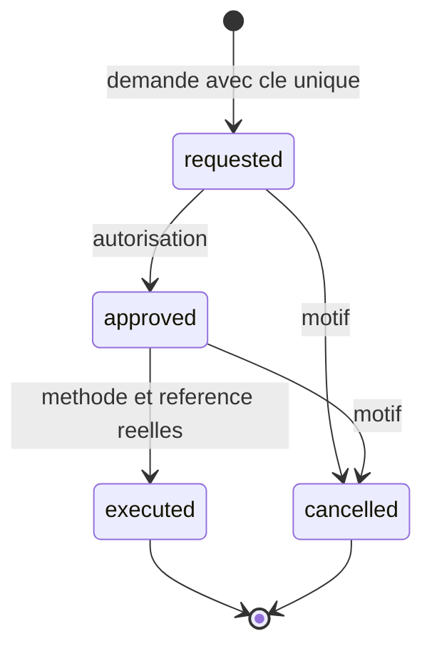

# Annulations et remboursements

L'annulation est une contrepassation de l'écriture, sans transfert bancaire. L'original, ses affectations et le motif restent conservés. Le moteur ignore alors son règlement ; le reçu indique son invalidation. Une demande de remboursement réservée ou un remboursement exécuté interdit l'annulation du paiement pour éviter une double restitution.

Le remboursement est géré par `PaymentRefundService` et `PaymentRefund` :

Le montant remboursable est le paiement initial moins les montants demandés, approuvés ou exécutés. Ces réservations sont vérifiées sous verrou du contexte puis du paiement. Une clé de demande unique ne peut désigner un autre montant ou paiement. La référence de décaissement est unique. Un rejeu d'exécution avec même méthode/référence ne crée rien ; une divergence est refusée.

L'exécution exige une attestation administrative du décaissement réel. Ce logiciel ne déclenche aucun virement et ne contacte aucun prestataire. L'autorisation seule n'affecte pas l'encaissement ; seule l'exécution diminue le net. Les fonds non affectés sont remboursés en premier ; le reliquat crée des `RefundAllocation` sur les dernières affectations, sans les effacer. Le remboursement intégral marque le paiement `refunded`; un partiel conserve `confirmed` et un reçu annoté.

`finance.dual_control=true` impose un autorisateur distinct du demandeur, et un confirmateur de versement distinct du saisisseur. Valeur initiale false, compatible avec le modèle d'équipe existant : l'établissement doit décider sa séparation des tâches. Il n'y a pas de double approbation automatique ni d'exécution externe inventée.

Les anciens paiements `refunded` sans preuve d'exécution restent des contrepassations historiques séparées dans les rapports ; ils ne sont jamais requalifiés en décaissements certifiés.
