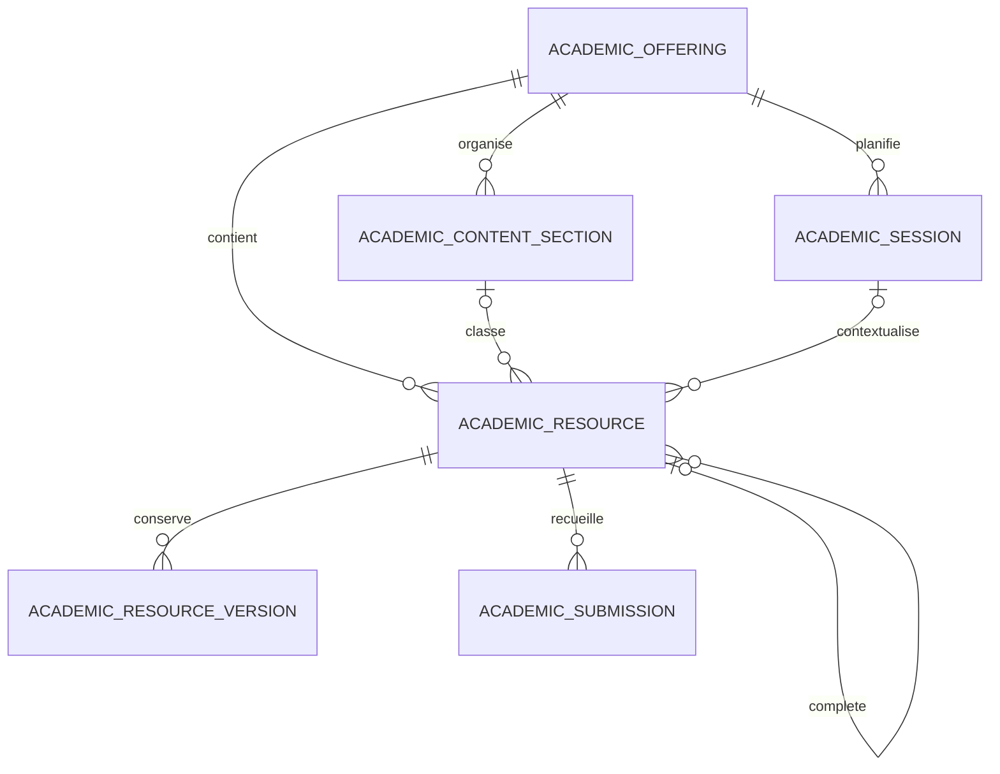

# Modèle des ressources pédagogiques

`academic_resources` reste la table de référence. L’offre définit le contexte d’accès. La section, la séance et le travail associé sont des références facultatives dans cette offre. Le statut courant est représenté par `is_published` et `archived_at`.

La ressource référence son fichier courant avec le disque, le chemin, le nom, le MIME, la taille et le SHA-256. Chaque version contient un instantané immuable de l’édition, son numéro, son auteur, sa date et son motif. Le stockage physique est partagé entre éditions ou ressources qui référencent le même objet.

La migration ajoute deux tables, des clés étrangères, un identifiant d’opération unique et des index pour les listes et les rattachements. Les ressources historiques gardent leur identifiant et leurs chemins. Leur version initiale est capturée au premier remplacement. Un auteur ou une date de publication inconnus restent vides.
