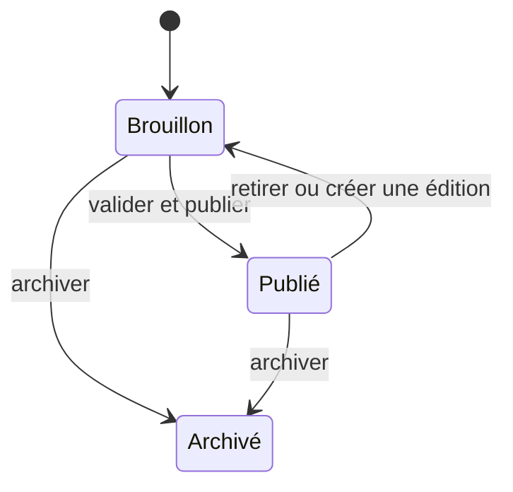
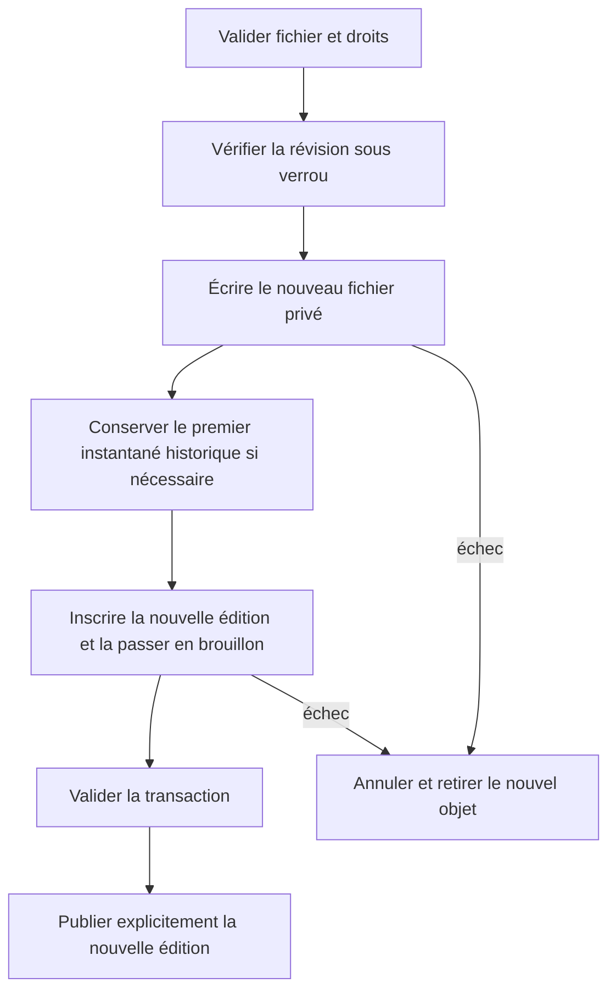

# Publication et versions

Les formulaires de bibliothèque créent des brouillons. La publication et le retrait exigent un motif. Une ressource publiée reste soumise à l’accessibilité de son offre. L’archivage retire la ressource des écrans étudiant, conserve le fichier et rend l’édition non modifiable. La bibliothèque conserve les archives et ne propose pas de route de suppression. Les points d’entrée historiques de création et de publication restent disponibles avec leur comportement explicite.

L’identifiant de requête déduplique les créations et réutilisations. La révision évite l’écrasement d’une édition concurrente. Un rejeu d’une publication déjà appliquée ne répète pas l’envoi. Le téléchargement autorisé en cours utilise le fichier résolu au départ. Les requêtes suivantes vérifient de nouveau le statut.
