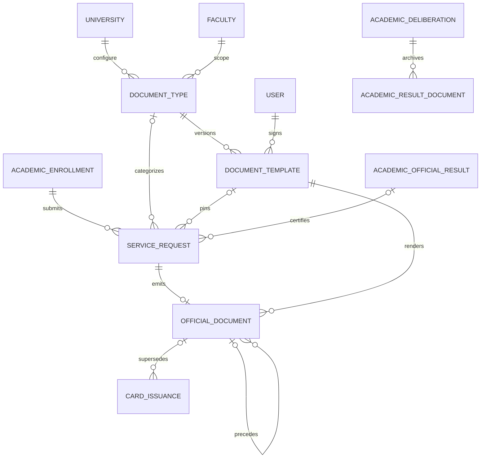

# Architecture documentaire

`App\Modules\Documents` porte le catalogue, les contrôles d’éligibilité, les transitions et l’archivage. Les contrôleurs HTTP et le job appellent les mêmes services. Le portail étudiant réutilise la résolution de l’inscription du portail. Le back-office réutilise les périmètres de faculté.

Le registre public interroge les archives de Documents et de Results. Les reçus passent par Finance. Aucune donnée du dossier n’est copiée dans une base publique.
