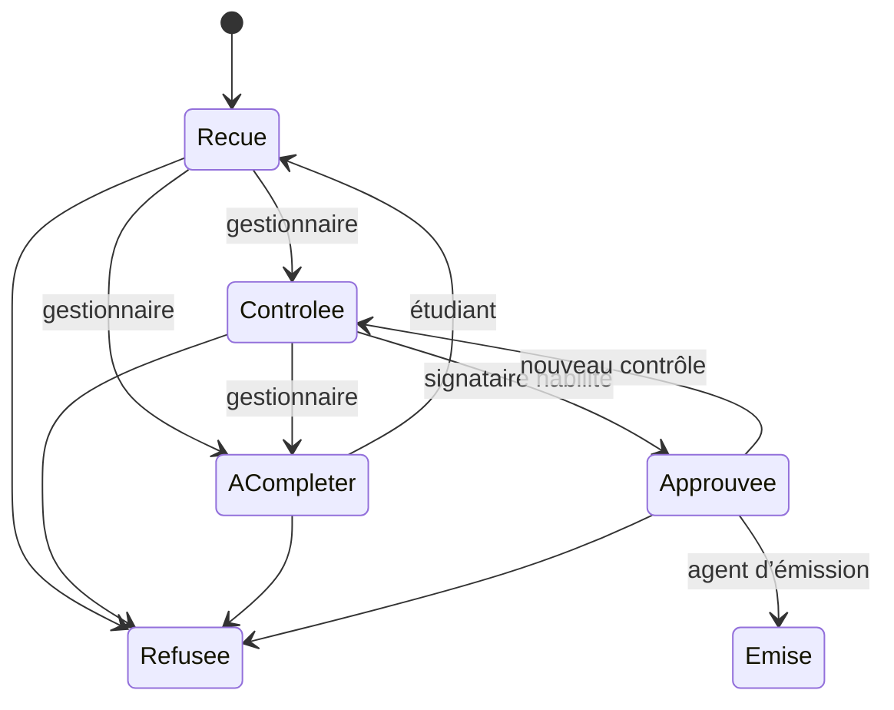

# Demandes et validations

Le motif est obligatoire. La clé d’opération UUID déduplique les reprises du dépôt. Une demande active par type et par inscription est garantie en base. Chaque transition compare la révision envoyée à celle du dossier verrouillé. Le signataire désigné approuve une empreinte des données et doit être distinct du dernier contrôleur. L’émission recalcule cette empreinte à partir des sources officielles.

Les notifications internes signalent la réception, la correction, le refus, l’approbation, l’émission, la remise et la révocation. Elles ouvrent la section de l’inscription du destinataire. L’envoi peut passer par la queue.
