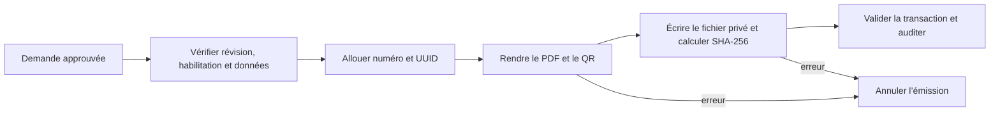

# Génération PDF

Le service partage Dompdf avec Results. Les ressources réseau et l’exécution de code sont désactivées. Les images privées sont vérifiées puis intégrées aux octets du PDF. BaconQrCode utilise PHP GD. Les attestations sont en A4, les cartes ont deux faces aux dimensions du modèle. Le rendu refuse une carte qui déborde sur une troisième page.

L’aperçu administratif indique son caractère provisoire. Le fichier archivé est servi directement après contrôle de l’empreinte. Le job optionnel appelle le même service et conserve la révision approuvée.
