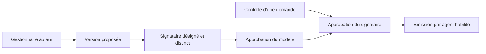

# Signatures et approbations

Une signature ou un cachet visuel PNG fourni par l’établissement peut accompagner les PDF A4. Le signataire peut vérifier les fichiers avant d’approuver le modèle. La qualité et le nom sont figés à l’émission. Un diplôme requiert une permission supplémentaire et un mandat explicite dans sa demande.

La validation applicative est journalisée. Les marques visuelles et le QR ne produisent pas une signature électronique cryptographique. L’établissement doit désigner ses autorités et ses procédures de conservation des marques.
