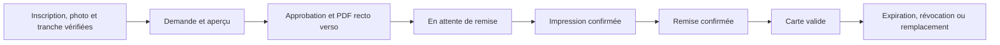

# Cartes étudiantes

Le modèle définit largeur, hauteur, marge et couleur. L’impression doit utiliser l’échelle 100 %. Le PDF rend le recto et le verso sur deux pages. Le QR est au verso. L’activation du type carte bascule la faculté vers le nouveau service. Une seule filière carte par faculté peut être active.

Le parcours historique reste disponible dans les facultés sans type carte actif. Une carte historique déjà imprimée requiert une demande interne de migration motivée. Le registre préserve son dossier historique et le rattache au successeur. La carte officielle attend sa remise avant d’apparaître valide. Un remplacement crée un numéro distinct et conserve le matricule.
