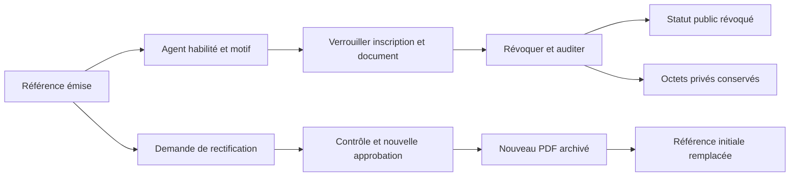

# Duplicatas, rectifications et révocations

Le duplicata conserve le contenu source et l’échéance maximale de la référence antérieure. Sa nouvelle référence et le motif sont historisés. Les cartes passent par un remplacement. La rectification commence par une correction dans le domaine propriétaire si nécessaire. Le gestionnaire dépose ensuite une nouvelle demande. Après approbation, le PDF de remplacement est archivé et l’ancienne référence est marquée remplacée.

Une révocation ou un remplacement porte sur la référence visée. Lorsque plusieurs duplicatas sont en circulation, le service traite aussi les références concernées.
