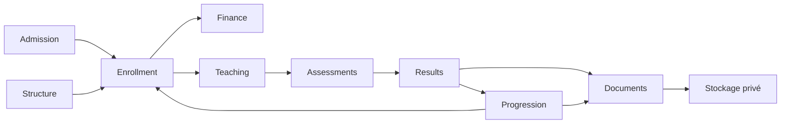

# Audit global

Audit du dépôt local le 10 novembre 2026. Le dernier commit visible au départ était `27a95e13`. L’arbre contenait 826 entrées modifiées, supprimées ou nouvelles, dont les phases antérieures et les builds Vite. La baseline utilise cet arbre de travail et compte 359 tests PHP réussis, avec 153 777 assertions. La production n’a pas été interrogée. [Baseline](evidence/sqlite-baseline.txt)

Laravel 12 héberge les domaines métier dans un monolithe. Le navigateur utilise Inertia et React. Le fichier de configuration local déclare MySQL avec cache, sessions et queue en base. Les tests utilisent SQLite en mémoire par défaut. PostgreSQL 16 a été exercé dans un conteneur jetable. Redis a été exercé sur un socket local privé. Ces constats ne déterminent pas le moteur ni la configuration de production.

Les frontières les plus sensibles sont la confirmation financière, le rattachement aux maquettes, la publication des résultats et l’émission documentaire. Les preuves et limites par domaine figurent dans la matrice. [Matrice fonctionnelle](02-matrice-couverture-fonctionnelle.md)
