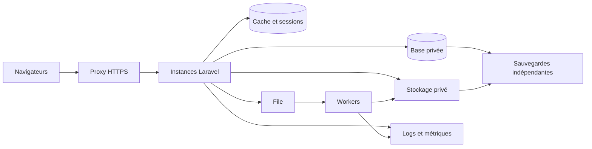

# Dimensionnement

| Option | Conditions d’usage | Contraintes |
| --- | --- | --- |
| Instance web simple, base et stockage persistants | Première recette et charge compatible avec une instance mesurée | Un point de panne, maintenance à planifier, contention PHP et jobs. |
| Instances web réparties, base dédiée, cache et stockage partagés, workers séparés | Quand la recette montre un besoin de répartition ou de disponibilité | Configuration plus coûteuse, cohérence des sessions, capacité SQL et monitoring. |

Calculer la concurrence de traitement à partir du débit observé multiplié par la durée moyenne de service. Estimer la mémoire des processus au p95 et limiter la somme des connexions de web, workers et supervision sous le plafond SQL, avec réserve opérationnelle. Dimensionner les workers à partir du taux d’arrivée et du temps de traitement PDF ou import. Le polling toutes les trente secondes représente jusqu’à environ 167 demandes par seconde pour 5 000 onglets actifs avant les autres actions. Vérifier le comportement réel des onglets et la distribution des routes. Le smoke local ne permet pas de choisir le nombre de serveurs.
